<picture>
  <source media="(prefers-color-scheme: dark)" srcset="cards/hero-dark.svg">
  
</picture>

  <picture><source media="(prefers-color-scheme: dark)" srcset="cards/stat-contributions-dark.svg"></picture>
  <picture><source media="(prefers-color-scheme: dark)" srcset="cards/stat-repos-dark.svg"></picture>
  <picture><source media="(prefers-color-scheme: dark)" srcset="cards/stat-streak-dark.svg"></picture>

<picture>
  <source media="(prefers-color-scheme: dark)" srcset="cards/activity-dark.svg">
  
</picture>

### Featured projects

  <a href="https://github.com/mananbatraa/researchpilot-ai"><picture><source media="(prefers-color-scheme: dark)" srcset="cards/project-1-dark.svg"></picture></a>
  <a href="https://github.com/mananbatraa/FRIDAY"><picture><source media="(prefers-color-scheme: dark)" srcset="cards/project-2-dark.svg"></picture></a>
  <a href="https://github.com/mananbatraa/ai-rag-knowledge-assistant"><picture><source media="(prefers-color-scheme: dark)" srcset="cards/project-3-dark.svg"></picture></a>
  <a href="https://github.com/mananbatraa/pyspark-data-engineering-pipeline"><picture><source media="(prefers-color-scheme: dark)" srcset="cards/project-4-dark.svg"></picture></a>

<picture>
  <source media="(prefers-color-scheme: dark)" srcset="cards/stack-dark.svg">
  
</picture>

  <a href="https://portfolio-puce-nu-45.vercel.app">Portfolio</a> ·
  <a href="https://www.linkedin.com/in/mananbatra03">LinkedIn</a> ·
  <a href="https://github.com/mananbatraa?tab=repositories">All repositories</a>

Cards are animated SVGs generated by <a href="scripts/render_cards.py">scripts/render_cards.py</a> and refreshed daily by GitHub Actions.
